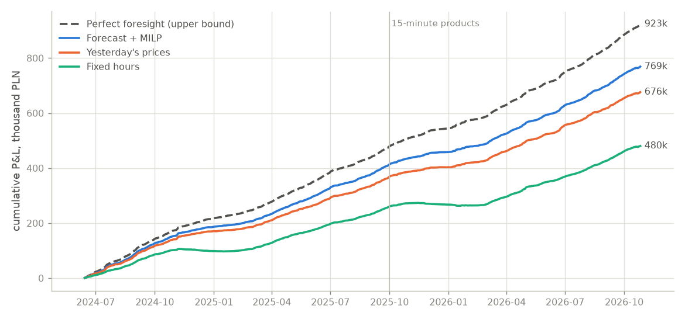
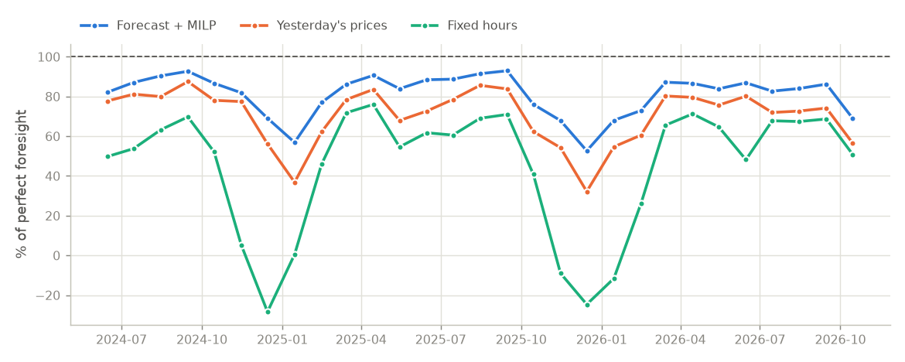
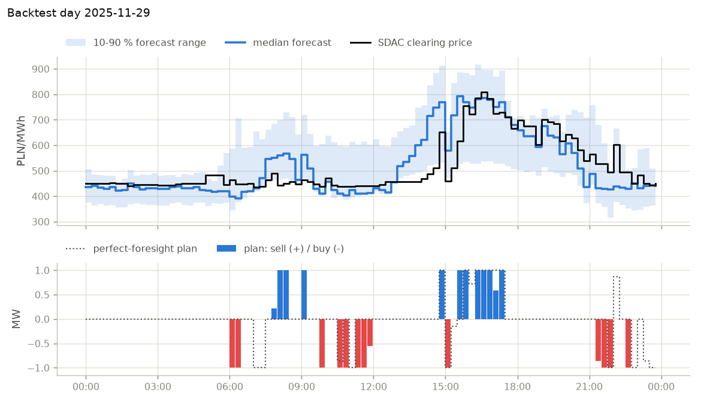

# pl-bess-paper-trading


**Website: https://kwwaleszczynski-del.github.io/pl-bess-paper-trading/** ·
**Archive of plans: [`track-record` branch](https://github.com/kwwaleszczynski-del/pl-bess-paper-trading/tree/track-record)**

A 1 MW / 2 MWh battery that trades the Polish day-ahead market **on paper**, every day. Each morning it forecasts
tomorrow's prices from the data published by then, plans when to charge and discharge, and commits the plan before
the 12:00 gate closure of the day-ahead auction (SDAC). The next day the plan is settled on the published clearing
prices and appended to a track record that is never recomputed, like the performance page of a fund.

> **Paper trading only.** No bids or offers are submitted to any market or exchange: a plan is a file in this
> repository, and its result is computed from public prices. This is a research and portfolio project, not
> investment, trading or financial advice. Simulated and past results say nothing reliable about future results.

Earlier projects of this portfolio ([bess-arbitrage-pl](https://github.com/kwwaleszczynski-del/bess-arbitrage-pl),
[pl-bess-revenue-stack](https://github.com/kwwaleszczynski-del/pl-bess-revenue-stack)) report upper bounds with
perfect foresight of prices. This one asks what a battery earns with a forecast it actually had to make in time,
and publishes the answer day by day.

## Results

**Live track record.** It starts with the first plan the daily workflow publishes and is shown on the
[website](https://kwwaleszczynski-del.github.io/pl-bess-paper-trading/) and in
[`ledger.csv`](https://github.com/kwwaleszczynski-del/pl-bess-paper-trading/blob/track-record/ledger.csv) of the
`track-record` branch. It is never mixed with the backtest below.

**Backtest** (simulated, walk-forward with as-of inputs, 14.06.2024 to 26.10.2026, 865 delivery days; P&L in PLN
for 1 MW / 2 MWh, net of the degradation cost):



| Strategy | P&L, PLN | PLN/MW/year | share of perfect foresight | cycles/day |
|---|---:|---:|---:|---:|
| **Forecast + MILP** (live strategy) | **768,762** | **324,391** | **83.2 %** | 1.38 |
| Yesterday's prices | 676,079 | 285,282 | 73.2 % | 1.40 |
| Last week's prices | 670,859 | 283,079 | 72.6 % | 1.40 |
| 7-day average | 772,551 | 325,990 | 83.7 % | 1.42 |
| Fixed hours | 480,317 | 202,677 | 52.0 % | 0.93 |
| Perfect foresight (upper bound) | 923,474 | 389,674 | 100 % | 1.40 |

| Price forecast | MAE, PLN/MWh | RMSE, PLN/MWh | rank correlation within the day |
|---|---:|---:|---:|
| **Quantile gradient boosting, median** | **105.5** | **163.7** | **0.834** |
| Yesterday's prices | 128.9 | 202.8 | 0.752 |
| Last week's prices | 150.9 | 231.7 | 0.754 |
| 7-day average | 125.3 | 185.6 | 0.819 |

Errors at the product resolution (hourly values until 30.09.2025). By period: with hourly products (474 days) the
model has an MAE of 97.3 PLN/MWh and earns 86.3 % of perfect foresight; with 15-minute products (391 days) 115.4
PLN/MWh and 79.9 %.

- **The forecast pays.** The forecast strategy earns 83 % of the perfect-foresight upper bound and 39,000 PLN/MW/year
  more than trading on yesterday's prices (95 % interval 34,000 to 44,000, bootstrap over weeks). It is ahead in
  every one of the 29 months and on 72 % of the days.
- **A better forecast is not automatically more money.** The plain 7-day average earns as much as the model
  (-1,600 PLN/MW/year for the model, 95 % interval -4,800 to +1,600) although its MAE is 19 % higher. The schedule
  depends on how the quarter-hours of a day rank against each other, and the 7-day average ranks them almost as
  well (0.819 vs 0.834) while being smoother. The live strategy keeps the model that was chosen before the backtest.
- **The quantile range is too narrow.** The 10-90 % range of the model contains 59 % of prices instead of 80 %.
- **Fixed hours** earn 52 % of perfect foresight and lose money in December 2024 and from November 2025 to
  January 2026, when noon is no longer the cheapest time to buy.
- **Bad days.** The model lost money on 29 of 865 days (yesterday's prices on 57, fixed hours on 153); the worst was
  22.10.2026 with -432 PLN, when perfect foresight earned 1,616 PLN. The largest daily gains (up to 4,245 PLN on
  24.06.2026) come on days with price spreads above 2,000 PLN/MWh.



A typical day of the 15-minute period (29.11.2025, the median gap to perfect foresight): the forecast gets the shape
of the day right but expects the afternoon rise too early; the plan buys in the morning and around noon and sells
into the morning and afternoon peaks, close to the perfect-foresight schedule (dotted).



## How it works

```
D-1, ~07:00    inputs of the plan published (prices up to D-1, system data up to 06:00)
D-1, first scheduled run that starts before 12:00 (attempts 07:10-10:40 CET, 08:10-11:40 CEST; GitHub Actions)
  settle every published day ──> ledger.csv (append only)
  load PSE data known at the decision
  forecast prices of D (quantile gradient boosting)
  optimise the schedule of D (MILP)
  commit plans/YYYY/D.json to the track-record branch   ── before 12:00, gate closure ──
  rebuild the website
D-1, ~13:30-14:45    PSE publishes the SDAC prices of D
next run             settle D (ledger row)
```

1. **Morning of D-1.** A scheduled workflow loads the PSE data known at the decision, fits the forecast models on
   the past year, predicts the price of every quarter-hour of D (median and 10-90 % range), optimises the battery
   schedule on the median and commits the plan, with its inputs, to the `track-record` branch. A plan is never
   replaced, and after 12:00 no plan is made. The workflow is scheduled five times between 07:10 and 10:40 CET
   (08:10 and 11:40 CEST): the first run that starts before the gate makes the plan, later runs find it and only
   settle and redeploy. The inputs are cut at fixed times, so the plan does not depend on which run makes it.
2. **Settlement.** Once the SDAC prices of D are published (early afternoon of D-1), the next run settles the plan on
   them, together with three benchmarks for the same day, and appends one row to `ledger.csv`. Rows are never
   rewritten, also when the code changes later; a day without a plan counts as no trade.
   **Days without a plan.** GitHub starts scheduled runs late when it is busy, usually by 30-60 minutes. On 30.10.2026
   the first run started at 14:34 Polish time, after the gate, so 31.10.2026 has no plan; until then the workflow had
   two attempts (07:40 and 09:40 CET), now five. Such a day stays in the ledger as `no_plan` with 0 PLN for the
   forecast strategy, while the benchmarks are settled as usual, and the website lists it under the live record.
3. **Website.** The page shows the open plan, the live track record from the first published plan on, and,
   clearly separated, the backtest.

### What is known at the decision

The forecast for delivery day D uses only what is published by about 07:00 Polish time on D-1 (`DECISION_LOCAL` in
`config.py`; in a check on 31.10.2026 system quarter-hours appeared about 40 minutes after their end). The plan is
issued by the first scheduled run after that which starts before the 12:00 gate; plans made by the earlier version of
the code record a nominal `decision_local` of 10:00 instead, with the same inputs. Publication times were read
from the `publication_ts` field of the [PSE reports API](https://api.raporty.pse.pl) in October 2026.

| Data (PSE report) | Published | Use at the decision for D |
|---|---|---|
| SDAC price of the Polish zone `csdac-pln`, RCE `rce-pln` | D-1 about 13:30-14:45, after the gate; not revised | prices up to D-1 are features; prices of D settle the plan |
| demand, wind and PV generation `his-wlk-cal` | near real time; republished the next night, corrected for up to about a month | used up to 06:00 on D-1 |
| day-ahead coordinated plan PKD `pdgopkd` (forecast demand, wind, PV) | D-1 about 15:30 | not usable (after the gate) |
| peak demand forecast `pdgsz`, reserve forecast `ro-prog` | D-1 from about 15:30 | not usable |
| 5-day coordination plan PK5L `pk5l-wp` (wind and PV forecasts, demand, reserves) | every afternoon (about 14:30-15:30) for today to D+5, updated during the day | the D-2 version is available, but the API keeps only the latest version of each hour, so it cannot be backtested; archived every morning for later models, not used yet |
| imbalance price forecast `price-fcst`, system cost forecast `sk` | during the delivery day | not usable |
| wind and PV forecast of [pl-res-forecast-climate](https://kwwaleszczynski-del.github.io/pl-res-forecast-climate/) | daily about 10:40, archived since 26.10.2026 | not used: no as-of history to backtest it on yet |
| calendar: weekday, Polish public holidays, season | known in advance | used |

So the model sees what any market participant sees from public PSE data before the gate: yesterday's auction
result, the system state of the night and the calendar. It does not see a weather or renewables forecast, which is
the main reason it misses windy or overcast surprises.

## Method

**Prices and products.** Settlement uses the SDAC clearing price of the Polish bidding zone (`csdac-pln`), the
price at which day-ahead bids for Poland clear. Until 30.09.2025 the products were hourly (the API repeats the
hourly price in four quarter-hours), from 1.10.2025 quarter-hourly. On hourly days the price signal of every
strategy is averaged to hours; the battery may still vary its power within the hour, and the market position is
the hourly net energy.

**Forecast.** For each quarter-hour $`t`$ of D a gradient boosting model per quantile
$`\tau \in \{0.1, 0.5, 0.9\}`$ (scikit-learn `HistGradientBoostingRegressor`) minimises the pinball loss

```math
L_\tau(y, \hat{y}) = \max\big(\tau\,(y - \hat{y}),\; (\tau - 1)\,(y - \hat{y})\big)
```

on 26 features: local time of day, weekday, public holidays of D and D-1, season, the prices of D-1, D-2 and D-7 at
the same local time and their 7-day mean, the shape of the price curve of D-1 (mean, minimum, maximum, standard
deviation, night, midday and evening means, share of negative prices), the mean price of D-7, a flag for 15-minute
products, the daily means of wind, PV and demand of D-2, and wind and demand of D-1 up to 06:00 (night mean and last
hour). The models are trained on the 365 delivery days
before D (prices of D-1 are known at the decision). The quantiles are sorted so that they never cross. The model
settings were fixed before the backtest and were not tuned on it.

Benchmarks of the forecast: **yesterday's prices** (D-1 at the same local time), **last week's prices** (D-7) and
the **7-day average** (D-1 to D-7).

**Schedule.** For a price signal $`\hat{p}_t`$ (PLN/MWh) over the quarter-hours of D, with $`\Delta t = 0.25`$ h,
the battery chooses charge $`c_t`$ and discharge $`d_t`$ (MW), solved as a mixed-integer linear program (HiGHS):

```math
\max_{c,\,d,\,u} \;\sum_t \hat{p}_t\,\Delta t\,(d_t - c_t) \;-\; k \sum_t \Delta t\, d_t
```

```math
\begin{aligned}
e_t &= e_{t-1} + \eta\,\Delta t\,c_t - \frac{\Delta t\,d_t}{\eta}, \qquad e_0 = e_T = 0.5\,E,\\
0.05\,E &\le e_t \le 0.95\,E,\\
0 \le c_t &\le P\,u_t,\qquad 0 \le d_t \le P\,(1 - u_t),\qquad u_t \in \{0, 1\},\\
\sum_t \Delta t\,d_t &\le 1.5 \cdot 0.9\,E
\end{aligned}
```

with $`P = 1`$ MW, $`E = 2`$ MWh, one-way efficiency $`\eta = \sqrt{0.87}`$ (87 % round trip) and a degradation
cost $`k = 30`$ PLN per MWh discharged, the same assumptions as the perfect-foresight projects of this portfolio.
The plan is a fixed schedule (price-taking quantities), as if submitted to SDAC without price limits.

**Settlement.** A plan $`(c_t, d_t)`$ is settled on the clearing prices $`p_t`$ of D:

```math
\Pi_D = \sum_{t \in D} p_t\,\Delta t\,(d_t - c_t) \;-\; k \sum_{t \in D} \Delta t\, d_t
```

**Strategies**, all with the same battery and the same settlement:

| Strategy | Price signal of the schedule |
|---|---|
| Forecast + MILP | median of the quantile forecast; the live strategy |
| Yesterday's prices | prices of D-1 at the same local time, known at the decision |
| Fixed hours | none: sell 07:00-09:00, buy 12:00-14:00, sell 19:00-21:00 every day at full power within the limits; the hours are those of the optimal schedule for the average price profile of 1.06.2023-13.06.2024, before the first backtest day |
| Perfect foresight | the clearing prices of D themselves: an upper bound that cannot be traded |

With perfect foresight on RCE prices the optimiser reproduces bess-arbitrage-pl exactly (307,838 PLN for 2025); on
the SDAC prices used here perfect foresight earns 327,663 PLN in 2025.

**Backtest.** Walk-forward from 14.06.2024, the first day of the PSE reports API: every week a new set of models
is fitted on the 365 delivery days before the week, and every day is forecast from its own as-of features. The
features of day D are looked up by date arithmetic from D-1, D-2 and D-7 only; a test changes all data after the
decision and checks that the features, the forecast and the plan stay the same.

**Where the backtest is not exactly as-of:**

- PSE system data (`his-wlk-cal`): the API serves only the latest revision, so the backtest sees corrected values
  where the live run sees first estimates (a bulk republication of 2024-2025 took place on 18.01.2026). They enter
  only as daily and night means of wind, PV and demand.
- The backtest refits the models weekly, the live run every day.
- Training data before 14.06.2024 come from the legacy PSE export: hourly RCE (the day-ahead market price before
  the balancing market reform of 14.06.2024) and hourly wind, PV and demand. They train the models of the first
  year of the backtest only.
- The settings were fixed before the backtest, but the project was designed after the period it tests, so the
  backtest is not a substitute for the live record.

## Limitations

- 1 MW is assumed too small to move prices. Exchange fees, imbalance settlement, grid tariffs, taxes and financing
  are ignored; the degradation cost is a flat 30 PLN/MWh.
- Only the day-ahead market: no intraday trading, balancing services or capacity market revenue
  (see [pl-bess-revenue-stack](https://github.com/kwwaleszczynski-del/pl-bess-revenue-stack) for those).
- A real trader would submit price-dependent bids and could adjust intraday; a fixed day-ahead schedule is a simple
  and conservative stand-in.
- The forecast uses no weather or renewables forecast (see the table above), which limits its accuracy on days with
  a wind or solar surprise.

## Usage

```bash
python -m venv .venv
.venv/Scripts/python -m pip install -e ".[dev]"      # Linux/macOS: .venv/bin/python

python -m bess_paper fetch                     # PSE data from 1.06.2023 into data/ (legacy export: ~30 min once)
python -m bess_paper backtest --offline --workers 4   # walk-forward backtest -> results/
python -m bess_paper figures                   # README figures -> docs/img/
python -m bess_paper daily --archive-dir archive      # settle published days, plan tomorrow (before 12:00)
python -m bess_paper site --archive-dir archive --out site
pytest -q                                      # synthetic data, no network
```

`daily --now 2026-10-27T09:30` replays a moment (Polish time) for testing: prices of day X count as published
from 15:00 on X-1 and system data from the end of each hour. The package depends on [pse-opendata](https://github.com/kwwaleszczynski-del/pse-opendata), installed
from GitHub at a fixed commit.

```
src/bess_paper/
  config.py        battery, market calendar, decision time and model settings
  data.py          PSE prices (SDAC; legacy RCE before 14.06.2024) and hourly system data via pse-opendata
  calendar_pl.py   Polish public holidays
  features.py      as-of features of a delivery day
  forecast.py      quantile gradient boosting and benchmark forecasts
  optimizer.py     MILP schedule, state of charge, settlement, feasibility check
  strategies.py    forecast, yesterday, fixed hours, perfect foresight
  backtest.py      walk-forward backtest and summary
  live.py          plan before the gate, archive, settlement, append-only ledger
  site.py          static website (Plotly.js), light and dark theme
  figures.py       README figures (matplotlib)
  cli.py           fetch | backtest | daily | site | figures
```

**Daily run and website.** [`daily.yml`](.github/workflows/daily.yml) is scheduled at 06:10, 06:40, 07:40, 08:40
and 09:40 UTC (07:10-10:40 CET, 08:10-11:40 CEST), so that a run delayed by GitHub still starts before the gate; a
run that starts after the gate settles and redeploys but makes no plan. It is **off by default**: scheduled runs only
act when the repository variable `DASHBOARD_SCHEDULE` is `on`, and Settings > Pages > Source must be "GitHub
Actions". The live track record begins with the first plan of the first such run. `docs/` holds a committed
backtest-only snapshot of the page, which Pages can serve before that (Deploy from a branch, `main`, `/docs`).

## Data source and terms of use

All data are public reports of **PSE S.A.** (Polskie Sieci Elektroenergetyczne, the Polish transmission system
operator), read through [pse-opendata](https://github.com/kwwaleszczynski-del/pse-opendata) from the reports API
`https://api.raporty.pse.pl/api` and, for June 2023 to 13 June 2024, from the legacy export of www.pse.pl:

| Source | Fields used | Meaning |
|---|---|---|
| `csdac-pln` | `csdac_pln` | SDAC day-ahead price of the Polish bidding zone, PLN/MWh |
| `his-wlk-cal` | `wi`, `pv`, `demand` | wind and PV generation, demand of the national power system, MW |
| `pk5l-wp` | all | 5-day coordination plan, archived at each decision (not used by the model) |
| legacy `PL_CENY_RYN_EN` | RCE | hourly day-ahead market price before 14.06.2024 (training only) |
| legacy `PL_GEN_WIATR`, `PL_WYK_KSE` | wind, PV, demand | hourly system data before 14.06.2024 (training only) |

**Terms of use.** PSE publishes conditions for re-using public sector information
([www.pse.pl, BIP, "Ponowne wykorzystywanie informacji sektora publicznego"](https://www.pse.pl/bip/ponowne-wykorzystanie-informacji-publicznej),
entry changed on 14 October 2026, checked on 26 October 2026). They allow commercial and non-commercial re-use of
information published on www.pse.pl free of charge, on condition that the user names the source and the date the
information was obtained, removes the PSE logo, and, when the information has been processed, tells recipients that
it was changed and how, without misleading them. PSE accepts no liability for processed information and notes that
some materials may be protected by copyright or database rights. These conditions are written for www.pse.pl; this
project applies them to the reports API of the same operator. Attribution as required:

> Information obtained from www.pse.pl (PSE S.A. reports `csdac-pln`, `his-wlk-cal`, `pk5l-wp` and the legacy
> export `PL_CENY_RYN_EN`, `PL_GEN_WIATR`, `PL_WYK_KSE`), state as of 26 October 2026. The information has been
> processed in whole or in part: prices averaged to hourly products where needed, used in forecast and optimisation
> models, and turned into schedules and simulated profit and loss. It is not an official PSE publication.

The main branch contains no raw PSE data, only derived results in `results/` and `docs/`. The `track-record`
branch contains, for each settled day, the clearing prices the plan was settled on and the PSE 5-day plan as seen
at the decision, so that every result can be checked. This project is not affiliated with or endorsed by PSE S.A.,
TGE or any market operator.

## License

Code: MIT, see [LICENSE](LICENSE). Data: PSE S.A. public reports, see
[Data source and terms of use](#data-source-and-terms-of-use).
